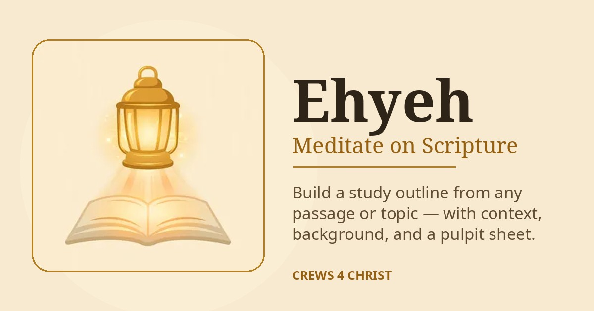

# Ehyeh — Meditate on Scripture

Ehyeh is a Bible study app that helps anyone build a sermon or study outline
from a passage or a topic: complete-phrase point titles in the passage's own
words, labelled context for every point, background from Easton's Bible
Dictionary, supporting references, a news connection with a named source and
date, and a clean large-type pulpit sheet for printing.

**Live app:** https://swava.ai/hagah/Hagah.html

Ehyeh costs $7, or free for anyone who doesn't have the money — the prayer
part is always free. The $7 pays for the ministry.

Built by Donnie Crews (Crews 4 Christ) as the entry for the Meta Global AI
Developer Hackathon. The study helper is a helper, not a teacher — check the
verses.

## What is in this repo

The complete Ehyeh app as served live: the page, its study modules (js/),
and its built-in data (data/) — the app runs from these static files.

Scripture texts and reference works in data/ are public domain: the King
James Version, the Geneva Bible (1599), the World English Bible, and
Easton's Bible Dictionary (1897).

## License

App code: MIT (see LICENSE). Scripture texts and dictionary content:
public domain.
